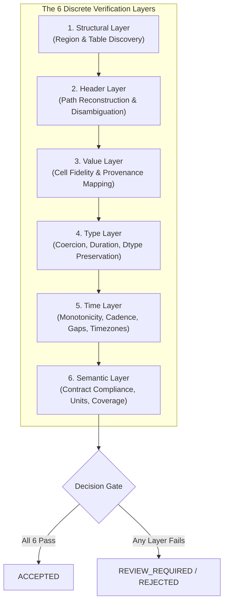

# Operational Testing Guide: How to Evaluate "Parsed Correctly"

**Standard Identifier:** `STD-AICONNEX-TEST-001`  
**Target System:** AICONNEX Industrial Excel Compiler (Phases 0–10+)  
**Baseline Standard:** Zero Silent Errors Over Automation Rate (`AGENTS.md` Rule 8)  
**Evaluation Scope:** 6-Layer Mechanical Oracle Comparison + Status Decision Matrix

---

## 1. The Hard Prerequisite: Labeled Ground-Truth Oracle

> [!IMPORTANT]
> **You cannot evaluate parsing correctness without a labeled oracle.**
> Running a test suite without expected targets measures only that the code did not throw an unhandled exception. It does **not** measure whether the compiled telemetry matches physical reality.

For every file in the test corpus, a domain expert or data steward must author an **`.expected.yaml`** oracle specification.

### Canonical Oracle Specification Schema

```yaml
# corpus/pnb_compressor/PNB950667_2025-11.expected.yaml
source_sha256: "bce6ad5760f02a1f679723810255dc9d9f6521cdfa92de664a777eb128e65263"
target_sheet: "PNB950667"

# Layer 1: Region Boundaries
expected_regions:
  - {range: "A6:J9",     kind: "METADATA_BLOCK"}
  - {range: "C10:BN11",  kind: "SUBHEADER_BAND"}
  - {range: "A12:BN12",  kind: "HEADER_ROW"}
  - {range: "A13:BN5293", kind: "DATA_TABLE"}

# Layer 1 Metadata Key-Values
expected_metadata:
  Station Name: "AKSHAY_MORBI"
  Compressor Serial No: "PNB950667"
  Compressor Type: "MOTOR"
  Service Engineer: "Mr. Shivam Upadhyay"
  Start Date & Time: "2025-11-01T00:00:00"
  End Date & Time: "2025-11-15T00:00:59"

# Layer 2: Reconstructed Column Paths & Types
expected_columns:
  - {path: "S/N",                           type: "int",      excluded: true}
  - {path: "DATE & TIME",                   type: "datetime", is_time_axis: true}
  - {path: "TOTAL HMR",                     type: "duration", format: "HH:MM:SS"}
  - {path: "SUCTION FLOW",                  type: "float",    unit: "SCM"}
  - {path: "DISCHARGE FLOW",                type: "float",    unit: "SCM"}
  - {path: "PT01",                          type: "float",    unit: "BAR"}
  - {path: "PT02",                          type: "float",    unit: "BAR"}
  - {path: "PT03",                          type: "float",    unit: "BAR"}
  - {path: "DISPENSER_I.HOSE_I.GAS_RATE",   type: "float",    unit: "KG/MIN"}
  - {path: "DISPENSER_I.HOSE_II.GAS_RATE",  type: "float",    unit: "KG/MIN"}
  - {path: "DISPENSER_II.HOSE_I.GAS_RATE",  type: "float",    unit: "KG/MIN"}
  - {path: "DISPENSER_II.HOSE_II.GAS_RATE", type: "float",    unit: "KG/MIN"}

# Layer 3, 4, 5 Dimensions
expected_row_count: 5281
expected_time_range: ["2025-11-04T00:00:00Z", "2025-11-15T00:00:00Z"]
expected_cadence_seconds: 180

# Layer 6 Contract & Review Decisions
expected_status: "ACCEPTED"
expected_review_items: []

# Spot-Check Value Provenance Assertions (Layer 3)
spot_check_cells:
  - {cell: "D13", signal: "SUCTION FLOW",    expected_val: 0.0}
  - {cell: "E13", signal: "DISCHARGE FLOW",  expected_val: 0.0}
  - {cell: "H13", signal: "PT01",            expected_val: 20.5}
  - {cell: "D20", signal: "SUCTION FLOW",    expected_val: 920.7}
  - {cell: "H20", signal: "PT01",            expected_val: 19.1}

# Expected Anomalies (Layer 6)
expected_anomalies:
  - {row: 20, kind: "STARTUP_TRANSIENT", detail: "PT03 stepped from 20.1 to 122.1"}
```

---

## 2. The Six Layers of Correctness

Correctness is **not** a single scalar metric. An extraction cannot be "95% correct." If a column shifted one column to the left, 95% of the numbers may match by coincidence, but every single telemetry reading is misattributed.



| Layer | Question Answered | Canonical Failure Example | Hard Metric / Pass Rubric |
| :--- | :--- | :--- | :--- |
| **1. Structural** | Did we locate the correct table and metadata bounds? | Metadata banner included as tabular data rows | $\ge 98\%$ bounding box overlap, zero metadata leakage |
| **2. Header** | Were column paths and namespaces reconstructed? | Repeated `GAS RATE` columns collapsed into one | 100% exact string match across signal paths |
| **3. Value** | Does every extracted cell match raw cell ground truth? | Precision truncated (`20.5` becomes `20.05`) | $\ge 99.99\%$ value match; 100% on critical sensors |
| **4. Type** | Are data types correctly parsed and coerced? | Totalizer `8633:10:51` parsed as timestamp or string | 100% dtype match; duration / floats preserved |
| **5. Time** | Is the time-axis aligned, cadence consistent, timezone UTC? | Missing timestamps filled with epoch 1970 | Monotonic time axis; cadence jitter $< 1\text{s}$ |
| **6. Semantic** | Does dataset satisfy client contract signals & coverage? | Missing mandatory `SUCTION FLOW` | 100% required signals present and within unit spec |

---

## 3. The Seven Status Decisions (The Safety Matrix)

Every batch processed by the compiler results in a status classification. We compare the **actual status** against the oracle's **expected status**:

```
+---------------------------------------------------------------------------------+
|                                 ACTUAL RESULT                                   |
|                  +-----------------------------+------------------------------+ |
|                  |          ACCEPTED           |       REVIEW_REQUIRED        | |
+------------------+-----------------------------+------------------------------+ |
| EXPECTED  ACCEPT | Correct Acceptance (PASS)   | False Reject (SAFE / COSTLY) | |
| EXPECTED  REVIEW | False Acceptance (FATAL)    | Correct Rejection (PASS)     | |
+------------------+-----------------------------+------------------------------+ |
```

### The Golden Metric: False-Accept Rate (FAR)

$$\text{FAR} = \frac{\text{False Accepts}}{\text{Total Accepted Publications}}$$

> [!CAUTION]
> **Release Blocking Rule:**
> A **single False Accept** on any critical sensor signal (Pressure, Flow, Temperature, Vibration) **immediately blocks release**.
> A false accept sends corrupted, misaligned telemetry directly to downstream AutoMLOps models, poisoning predictive maintenance weights.
> Conversely, a **Correct Reject** (`REVIEW_REQUIRED`) is counted as a **PASS**. An industrial compiler that halts on ambiguity is operating correctly.

---

## 4. The Evaluation Harness (`compiler.bench`)

The evaluation harness is executed via the CLI module:

```bash
uv run python -m compiler.bench evaluate \
  --compiler ./src/compiler \
  --corpus corpus/pnb_compressor/ \
  --oracle corpus/pnb_compressor/*.expected.yaml \
  --output reports/latest/
```

### Artifact Deliverables Produced

1. **`reports/latest/summary.json`**: Machine-readable evaluation matrix:
   ```json
   {
     "run_id": "2026-10-24T12:00:00Z",
     "compiler_version": "0.1.0",
     "total_workbooks": 10,
     "passed_workbooks": 9,
     "failed_workbooks": 1,
     "layer_scores": {
       "structural": 1.0,
       "header": 1.0,
       "value": 0.9999,
       "type": 1.0,
       "time": 0.90,
       "semantic": 1.0
     },
     "decision_matrix": {
       "correct_accept": 8,
       "correct_reject": 1,
       "false_accept": 0,
       "false_reject": 0,
       "wrong_review_reason": 1
     },
     "false_accept_rate": 0.0,
     "p50_latency_seconds": 4.1,
     "p95_latency_seconds": 6.8
   }
   ```

2. **`reports/latest/<FILE_ID>.diff.md`**: Human-readable discrepancy diff for debugging failures:
   ```markdown
   # Diff Report: PNB950667_2025-11.xlsx — FAILED (Time Layer)

   ## 1. What was expected
   - Time axis parsed from Column `DATE & TIME` (Col 2).
   - Start: 2025-11-04T00:00:00Z, End: 2025-11-15T00:00:00Z.

   ## 2. What the compiler produced
   - All rows yielded `1970-01-01T00:00:00Z`.

   ## 3. Root Cause Analysis
   - In `PlanExecutor._resolve_timestamp()`, the column label `"DATE & TIME"`
     contains both `"DATE"` and `"TIME"`. The exclusive check
     `if "TIME" in name and "DATE" not in name` failed both branches.

   ## 4. Remediation Action
   - Update `_resolve_timestamp()` to treat `("DATE" in name and "TIME" in name)`
     as a combined ISO datetime column. Rerun evaluation harness.
   ```

---

## 5. Pass / Fail Thresholds by Category

| Corpus Category | Purpose | Structural | Header | Value | Type | Time | Semantic | FAR Ceiling |
| :--- | :--- | :---: | :---: | :---: | :---: | :---: | :---: | :---: |
| **`excel_simple`** | Flat single-header tabular sheets | 100% | 100% | 100% | 100% | 100% | 100% | **0.00%** |
| **`excel_complex`** | Multi-level merged headers, dispensers | 100% | 100% | 99.99% | 100% | 100% | 100% | **0.00%** |
| **`excel_scattered`** | Irregular blocks, wide metadata banners | $\ge 95\%$ | 100% | 99.90% | 100% | 100% | 100% | **0.00%** |
| **`zip_mixed`** | Multi-file batches, temporal stitching | 100% | 100% | 99.99% | 100% | 100% | 100% | **0.00%** |
| **`failure_cases`** | Truncated, corrupt, wrong unit archives | N/A | N/A | N/A | N/A | N/A | N/A | **0.00%** |

*Note: In `failure_cases`, 100% of files must be rejected (`REVIEW_REQUIRED`). Any `ACCEPTED` status is a test failure.*

---

## 6. Phase 10 Concrete Acceptance Protocol

The exit test for Phase 10 is an end-to-end integration test executed through the Control Plane API:

```python
def test_phase_10_acceptance_criteria():
    """Phase 10 Exit Gate:
    1 upload of batch_5_compressors.zip reaches either published Parquet
    or explainable review states with full provenance.
    """
    # 1. Submit through API
    create_resp = client.post("/api/v1/jobs", json={"contract_id": "contract_5_compressors"})
    job_id = create_resp.json()["job_id"]
    
    upload_resp = client.post(
        f"/api/v1/jobs/{job_id}/upload",
        files={"file": ("batch_5_compressors.zip", zip_bytes, "application/zip")},
    )
    assert upload_resp.status_code == 202

    # 2. Wait for terminal status
    job_record = await_job_terminal_state(job_id)
    assert job_record.status in (JobStatus.ACCEPTED, JobStatus.REVIEW_REQUIRED)

    # 3. Assert Published Artifacts in Object Store
    dataset_id = job_record.dataset_id
    assert store.exists(f"{tenant_id}/{project_id}/published/{dataset_id}/tables/batch-measurements.parquet")
    assert store.exists(f"{tenant_id}/{project_id}/published/{dataset_id}/provenance/batch-source-map.parquet")
    assert store.exists(f"{tenant_id}/{project_id}/published/{dataset_id}/validation-report.json")
    assert store.exists(f"{tenant_id}/{project_id}/published/{dataset_id}/handoff-manifest.json")

    # 4. Assert Downstream AutoMLOps Reader Contract
    meas_bytes = store.get(f"{tenant_id}/{project_id}/published/{dataset_id}/tables/batch-measurements.parquet")
    table = pq.read_table(io.BytesIO(meas_bytes))
    assert table.num_rows > 0
    assert "observation_key" in table.column_names
    assert "timestamp_utc" in table.column_names
    assert "signal_id" in table.column_names
    assert "value" in table.column_names

    # 5. Assert 100% Provenance Traceability
    prov_bytes = store.get(f"{tenant_id}/{project_id}/published/{dataset_id}/provenance/batch-source-map.parquet")
    prov_table = pq.read_table(io.BytesIO(prov_bytes))
    assert prov_table.num_rows == table.num_rows
    assert set(table.column("observation_key")) == set(prov_table.column("observation_key"))
```

---

## 7. The Regression Discipline

Whenever code or recipes are updated, engineers must observe the three immutable laws:

1. **Law 1: Never edit an oracle to match buggy compiler output.**
   If the oracle specifies `PT01` must be $20.5$ and the compiler produces $0.0$, the compiler is broken. Altering `.expected.yaml` to expect $0.0$ invalidates ground truth.
2. **Law 2: A correct rejection is a pass.**
   If an ambiguous or drifting spreadsheet is routed to `REVIEW_REQUIRED`, that is a system success, not a defect.
3. **Law 3: One false accept halts the release pipeline.**
   No PR may merge and no release tag may be minted if `false_accept_rate > 0.0`.
